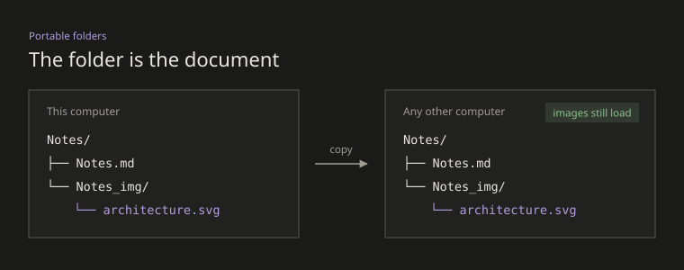

# Welcome to MDWisp

MDWisp is a local Markdown reader and editor. Your documents stay as ordinary files, and images travel with their document folder.

## Write and save

Start typing in a blank document. Press **Ctrl+N** for a new document and **Ctrl+S** to choose its name and location. Canceling the save dialog keeps the draft in memory.

Autosave and version history begin after the first save, according to Settings. Untitled drafts have neither. New/open commands and repeated app launches use new windows and preserve your current work. When closing a window, choose Save, Don't save or Cancel for unsaved changes.

## Follow links

Hold **Ctrl** while clicking a link; the cursor becomes a hand. On macOS, use **Cmd**.

- Relative Markdown links open in a new MDWisp window, including links between language versions of a README.
- Web links open in the default browser; email links open the mail handler.
- [Heading links](#write-and-save) jump within the document.
- Links in tables and reference-style links work the same way.
- An ordinary click keeps the editor ready for text editing.

```markdown
[English](README.md) · [简体中文](README.zh-CN.md)
[Website](https://example.com)
[Section](#write-and-save)
```

Escaping the opening parenthesis, as in `[English]\(README.md)`, makes literal text rather than a Markdown link.

## Portable folders

Use this structure for sharing a document with its images:

```text
Notes/
├── Notes.md
└── Notes_img/
    └── architecture.svg
```



Save before inserting images. Paste an image, drop image files into the editor, or use **Ctrl+Shift+I**. Images are saved beside the document and referenced with relative paths. Use **Organize into a document folder** for loose Markdown files. Share or archive the whole folder so links remain valid.

Two small buttons beside the document name in the title bar show the document in File Explorer and copy its full path.

## Markdown editing

Use **bold**, *italic*, ~~strikethrough~~, ==highlight== and `inline code`. Headings, lists, blockquotes, tasks, tables and fenced code blocks keep their original Markdown source.

> The editor hides formatting markers with decorations. It does not rewrite the document to produce the preview.

- [x] Save a document
- [ ] Add an image
- [ ] Share the document folder

### Tables

| Action | Shortcut |
| :--- | :--- |
| Insert table | Ctrl+Alt+T |
| Insert row above | Ctrl+Enter |
| Sort ascending | Ctrl+Alt+Up |
| Open command palette | Ctrl+P |

Click a cell to edit it. Table tools also support row and column operations, alignment, statistics, merging and conversion. Available commands appear in the toolbar, context menu and command palette.

### Code

```python
def greet(name):
    return f"Hello, {name}!"
```

Choose an explicit language or let local rules detect it. Uncertain detection remains plain text. Code detection works offline without a model or network request.

### Extended syntax

Subscripts such as H~2~O and superscripts such as x^2^ show in the editor and in exports. Footnotes[^note] and definition lists stay as source in the editor and render in HTML export. Math shows as styled TeX source in the editor and as formulas in HTML export. Mermaid and `[TOC]` stay as source.

[^note]: A footnote rendered in HTML export.

Document folder
: A folder whose name matches the Markdown file and the prefix of its image directory.

## Format sampler

Every special format the editor knows appears below once. After a change, reading it top to bottom and Ctrl+clicking each link is a full check.

### Inline formats

**Bold**, *italic*, ***bold italic***, ~~strikethrough~~, ==highlight==, <u>underline</u>, `inline code`, H~2~O, x^2^, inline math $E = mc^2$ and a footnote[^sample]. Prices like $5 and $10 are not math; an escaped `\*` shows as \*asterisks\*.

[^sample]: Footnotes stay as source in the editor.

### Links

- Bare URLs: https://github.com/ArthurLauCS/MDWisp and the releases page (https://github.com/ArthurLauCS/MDWisp/releases).
- An [inline link](https://github.com/ArthurLauCS/MDWisp/releases), an autolink <https://example.com>, www.example.com and someone@example.com.
- A reference link: [report an issue][issues].
- In-document: [Write and save](#write-and-save); same document by relative path: [Follow links](./Welcome.md#follow-links).

[issues]: https://github.com/ArthurLauCS/MDWisp/issues

### Lists

1. First ordered item
2. Second item with a nested list
   - Nested bullet with `code` and a [link](#format-sampler)
   - [x] Nested done task
   - [ ] Nested open task
3. Third item

### Quotes and rules

> A quote with **bold** and a [link](#links).
>
> > A nested quote.

---

### Formats in a table

| Format | Source | Result |
| :--- | :---: | ---: |
| Link | `[home](https://github.com/ArthurLauCS/MDWisp)` | [home](https://github.com/ArthurLauCS/MDWisp) |
| Code | `` `x = 1` `` | `x = 1` |
| Emphasis | `**bold** *italic*` | **bold** *italic* |

### Display math

$$
\int_0^1 x^2 \, dx = \frac{1}{3}
$$

## Appearance and language

Open **Settings → Appearance & fonts → Interface language** to switch between **English** and **简体中文**. The choice applies immediately and is remembered on restart. Existing document text is never translated automatically.

Choose dark or light appearance, fonts and text size. Drag either page edge to adjust margins; double-click to reset. The sidebar contains the outline or file tree.

## History and export

Open History to inspect snapshots, compare versions or restore a previous version. Restoring first records the current content, and can be undone. Clearing history is permanent.

Press **Ctrl+Shift+E** to export plain Markdown, a ZIP document folder, a self-contained HTML file or PDF. Review the preview before choosing the output location. ZIP export requires a document folder.

## Keyboard and AI help

Press **F1** for searchable shortcuts, or **Ctrl+P** for commands. Help contains the portable-document rules and installation commands for Claude Code, Codex and Cursor.

MDWisp was formerly named MDView. The existing `mdview` data directory is preserved for settings and history. New AI skill installations use `mdwisp` commands; previously installed skills are left untouched.
